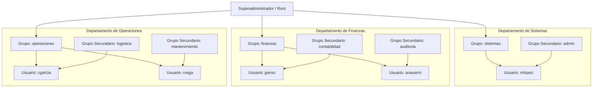

# Manual Técnico: Automatización de Administración de Usuarios, Grupos y Políticas de Acceso

**Materia**: Sistemas Operativos  
**Unidad**: Unidad 3 - Administración de Usuarios, Procesos y Seguridad  
**Actividad**: Tarea 3.1  
**Repositorio GitHub**: `https://github.com/Alan-Az/Unidad_3/tree/main/Tarea_3.1`  
**Enlace Video YouTube**:  

---

## 1. Introducción y Alcance

Este manual documenta la arquitectura, diseño e implementación de una solución automatizada para la administración del ciclo de vida de usuarios (altas, bajas, asignación de directorios, membresías grupales y expiración de credenciales) y la aplicación de políticas restrictivas de seguridad (control de acceso temporal, delegación administrativa estricta y bloqueo de cuentas por fuerza bruta).

La solución cuenta con soporte para **Linux (Ubuntu/Debian vía Bash)** y **Windows (PowerShell)**, bajo principios de Clean Code, mínimo privilegio e idempotencia.

---

## 2. Esquema Organizativo y Roles Departamentales

### 2.1 Diagrama Jerárquico de Grupos y Roles



#### Representación Esquemática en Texto (Garantizada para exportación a PDF)

```text
[Superadministrador / Root]
 ├── [sistemas] (Sudoers Total: ALL)
 │    └── admin
 │         └── mlopez (Maria Lopez)
 │
 ├── [finanzas] (Sin privilegios Sudo)
 │    ├── contabilidad
 │    │    └── jperez (Juan Perez)
 │    └── auditoria
 │         └── anavarro (Ana Navarro)
 │
 └── [operaciones] (Sudoers Restringido: systemctl status, journalctl)
      ├── logistica
      │    └── cgarcia (Carlos Garcia)
      └── mantenimiento
           └── rvega (Roberto Vega)
```

---

### 2.2 Matriz de Control de Acceso Basado en Roles (RBAC)

| Rol / Departamento | Grupo Primario | Grupos Secundarios | Horario Permitido | Privilegios Sudo / Admin | Permiso Home (`/home/<user>`) |
| :--- | :--- | :--- | :--- | :--- | :--- |
| **Sistemas** | `sistemas` | `admin` | **24/7** (Sin restricción) | Total: `ALL=(ALL:ALL) ALL` | `0700` (`rwx------`) |
| **Finanzas** | `finanzas` | `contabilidad`, `auditoria` | **Lun-Vie 08:00 a 18:00** | **Ninguno** (Comandos sudo denegados) | `0700` (`rwx------`) |
| **Operaciones** | `operaciones` | `logistica`, `mantenimiento`| **Lun-Vie 08:00 a 18:00** | **Restringido**: `systemctl status *`, `journalctl` | `0700` (`rwx------`) |

---

## 3. Políticas de Seguridad Implementadas

### 3.1 Aislamiento de Directorios Home
* **Mecanismo**: Cada directorio personal `/home/<usuario>` es aprovisionado con máscara estricta `0700` (`chmod 700`).
* **Objetivo**: Asegurar confidencialidad entre departamentos. Ningún usuario común puede listar (`ls`), leer (`cat`) ni acceder (`cd`) a la carpeta personal de otro compañero.

### 3.2 Forzado de Cambio de Contraseña Temporal
* **Mecanismo**: El comando `chage -d 0 <usuario>` (o `Set-LocalUser -PasswordExpired $true` en Windows) marca la contraseña generada como vencida inmediatamente al momento del aprovisionamiento.
* **Objetivo**: Obliga al usuario a ingresar la clave temporal y definir una clave personal definitiva antes de obtener acceso al shell.

### 3.3 Control de Horarios de Acceso (`pam_time`)
* **Mecanismo**: Módulo de seguridad PAM en `/etc/security/time.conf` con la regla:
  ```text
  *;*;!sistemas;Wk0800-1800
  ```
* **Objetivo**: Bloquea intentos de inicio de sesión de Finanzas y Operaciones fuera de días hábiles o fuera del rango 08:00 a 18:00 horas. El departamento de Sistemas mantiene acceso continuo.

### 3.4 Control Granular de Sudoers
* **Mecanismo**: Archivo modular `/etc/sudoers.d/tarea31_seguridad` con permisos `0440`, auditado con `visudo -cf`.
* **Objetivo**: Evita accesos no autorizados a comandos de configuración del sistema y audita violaciones en `/var/log/auth.log`.

### 3.5 Bloqueo por Intentos Fallidos (`pam_faillock`)
* **Mecanismo**: Directiva en `/etc/security/faillock.conf`:
  * Umbral: `deny = 3` (3 fallos consecutivos).
  * Ventana de cálculo: `fail_interval = 900` (15 minutos).
  * Duración del bloqueo: `unlock_time = 300` (5 minutos).
* **Objetivo**: Mitigar ataques de fuerza bruta en contraseñas locales.

---

## 4. Código Fuente Documentado

### 4.1 Script de Altas Masivas (`linux/altas.sh`)

```bash
#!/usr/bin/env bash
# Encabezado defensivo: detiene el script ante fallos, variables vacías y errores en tuberías
set -euo pipefail
IFS=$'\n\t'

readonly LOG_FILE="/var/log/altas_usuarios.log"
readonly CREDENTIALS_FILE="/root/credenciales_temporales.txt"

# Función centralizada de logging con marcas de tiempo
log() {
    local nivel="$1"
    local mensaje="$2"
    local timestamp
    timestamp=$(date '+%Y-%m-%d %H:%M:%S')
    echo "[$timestamp] [$nivel] $mensaje" | tee -a "$LOG_FILE"
}

# Validación previa de privilegios root y existencia del archivo CSV de entrada
validar_entorno() {
    if [[ $EUID -ne 0 ]]; then
        echo "[ERROR] Este script debe ejecutarse con privilegios de root (sudo)." >&2
        exit 1
    fi
    if [[ $# -ne 1 || ! -f "$1" ]]; then
        echo "[ERROR] Archivo CSV no proporcionado o inexistente." >&2
        exit 1
    fi
}

# Creación idempotente de grupos: verifica con getent antes de invocar groupadd
asegurar_grupo() {
    local grupo="$1"
    if ! getent group "$grupo" >/dev/null 2>&1; then
        groupadd "$grupo"
        log "INFO" "Grupo '$grupo' creado."
    fi
}

# Lógica atómica de creación de usuario, contraseñas y permisos
crear_usuario() {
    local user="$1"
    local nombre="$2"
    local prim_group="$3"
    local sec_groups="$4"
    local dias_exp="$5"

    # Evitar duplicados
    if id "$user" >/dev/null 2>&1; then
        log "WARN" "El usuario '$user' ya existe. Omitiendo."
        return 0
    fi

    asegurar_grupo "$prim_group"

    # Procesar lista de grupos secundarios separados por coma
    local clean_sec_groups=""
    local IFS_ORIG="$IFS"
    IFS=','
    for g in $sec_groups; do
        g=$(echo "$g" | xargs)
        if [[ -n "$g" ]]; then
            asegurar_grupo "$g"
            [[ -z "$clean_sec_groups" ]] && clean_sec_groups="$g" || clean_sec_groups="$clean_sec_groups,$g"
        fi
    done
    IFS="$IFS_ORIG"

    # Alta en el sistema con home interactivo (-m) y shell bash (-s)
    if [[ -n "$clean_sec_groups" ]]; then
        useradd -m -s /bin/bash -g "$prim_group" -G "$clean_sec_groups" -c "$nombre" "$user"
    else
        useradd -m -s /bin/bash -g "$prim_group" -c "$nombre" "$user"
    fi

    # Generación de contraseña temporal con entropía alta
    local temp_pass="Temp.$(openssl rand -hex 4)A1!"
    echo "$user:$temp_pass" | chpasswd

    # Forzar expiración inmediata para exigir cambio en primer inicio
    chage -d 0 "$user"

    # Configurar fecha límite de cuenta activa
    local fecha_exp
    fecha_exp=$(date -d "+$dias_exp days" +%Y-%m-%d)
    chage -E "$fecha_exp" "$user"

    # Aislamiento estricto de directorio
    chmod 700 "/home/$user"
    chown "$user:$prim_group" "/home/$user"

    log "INFO" "Usuario '$user' creado exitosamente | Grupo: $prim_group | Expira: $fecha_exp"
    echo "Usuario: $user | Password Temporal: $temp_pass | Expira: $fecha_exp" >> "$CREDENTIALS_FILE"
}

# Orquestador principal
main() {
    validar_entorno "$@"
    local csv_file="$1"

    mkdir -p "$(dirname "$LOG_FILE")"
    touch "$LOG_FILE" && chmod 600 "$LOG_FILE"
    touch "$CREDENTIALS_FILE" && chmod 600 "$CREDENTIALS_FILE"

    log "INFO" "=== Iniciando aprovisionamiento masivo desde: $csv_file ==="

    while IFS=',' read -r user nombre prim_group sec_groups dias_exp || [[ -n "$user" ]]; do
        user=$(echo "$user" | tr -d '\r' | xargs)
        nombre=$(echo "$nombre" | tr -d '\r' | xargs)
        prim_group=$(echo "$prim_group" | tr -d '\r' | xargs)
        sec_groups=$(echo "$sec_groups" | tr -d '\r' | xargs)
        dias_exp=$(echo "$dias_exp" | tr -d '\r' | xargs)

        [[ "$user" == "usuario" || -z "$user" || "$user" =~ ^[[:space:]]*# ]] && continue

        crear_usuario "$user" "$nombre" "$prim_group" "$sec_groups" "$dias_exp"
    done < "$csv_file"

    log "INFO" "=== Proceso finalizado. Credenciales registradas en: $CREDENTIALS_FILE ==="
}

main "$@"
```

---

### 4.2 Script de Revocación y Bajas (`linux/bajas.sh`)

```bash
#!/usr/bin/env bash
set -euo pipefail
IFS=$'\n\t'

readonly LOG_FILE="/var/log/bajas_usuarios.log"
readonly BACKUP_DIR="/var/backups/homes"
readonly CREDENTIALS_FILE="/root/credenciales_temporales.txt"

log() {
    local nivel="$1"
    local mensaje="$2"
    echo "$(date '+%Y-%m-%d %H:%M:%S') [$nivel] $mensaje" | tee -a "$LOG_FILE"
}

validar_entorno() {
    if [[ $EUID -ne 0 ]]; then
        echo "[ERROR] Requiere privilegios de root (sudo)." >&2
        exit 1
    fi
    if [[ $# -ne 1 ]]; then
        echo "Uso: $0 <nombre_usuario | ruta_archivo.csv>" >&2
        exit 1
    fi
}

eliminar_usuario() {
    local user="$1"

    if ! id "$user" >/dev/null 2>&1; then
        log "WARN" "El usuario '$user' no existe en el sistema. Omitiendo."
        return 0
    fi

    # 1. Bloqueo inmediato de cuenta
    passwd -l "$user" >/dev/null 2>&1 || true
    usermod -e 1 "$user" >/dev/null 2>&1 || true

    # 2. Terminación de procesos en ejecución
    pkill -9 -u "$user" >/dev/null 2>&1 || true

    # 3. Empaquetado y respaldo del home
    if [[ -d "/home/$user" ]]; then
        mkdir -p "$BACKUP_DIR"
        local backup_file="$BACKUP_DIR/${user}_$(date +%Y%m%d_%H%M%S).tar.gz"
        tar -czf "$backup_file" -C "/home" "$user" 2>/dev/null || true
        log "INFO" "Directorio /home/$user respaldado en: $backup_file"
    fi

    # 4. Eliminación de cuenta en /etc/passwd, /etc/shadow y borrado de home original
    userdel -r "$user" 2>&1 | grep -v "mail spool.*not found" || true
    log "INFO" "Usuario '$user' eliminado del sistema."

    # 5. Purga de credenciales temporales registradas
    if [[ -f "$CREDENTIALS_FILE" ]]; then
        sed -i "/Usuario: $user /d" "$CREDENTIALS_FILE" 2>/dev/null || true
    fi
}

main() {
    validar_entorno "$@"
    local target="$1"

    mkdir -p "$(dirname "$LOG_FILE")"
    touch "$LOG_FILE" && chmod 600 "$LOG_FILE"

    if [[ -f "$target" ]]; then
        log "INFO" "=== Procesando bajas por lote desde archivo: $target ==="
        while IFS=',' read -r user _resto || [[ -n "$user" ]]; do
            user=$(echo "$user" | tr -d '\r' | xargs)
            [[ "$user" == "usuario" || -z "$user" || "$user" =~ ^[[:space:]]*# ]] && continue
            eliminar_usuario "$user"
        done < "$target"
    else
        log "INFO" "=== Procesando baja individual para: $target ==="
        eliminar_usuario "$target"
    fi

    log "INFO" "=== Operación de bajas finalizada ==="
}

main "$@"
```

---

## 5. Evidencias de Validación Técnica

> *Nota para el alumno: Inserta las capturas de pantalla de la terminal de tu máquina virtual en los recuadros indicados abajo antes de generar el PDF definitivo.*

### 5.1 Evidencia 1: Ejecución del Script de Altas por Lote
Comando ejecutado: `sudo ./altas.sh ../usuarios.csv`  
*Descripción*: Demuestra la creación exitosa de las cuentas departamentales y la generación de contraseñas temporales en `/root/credenciales_temporales.txt`.

```text
[INSERTAR AQUÍ CAPTURA DE PANTALLA: Salida en consola de altas.sh y cat de credenciales_temporales.txt]
```

---

### 5.2 Evidencia 2: Cambio Forzado de Contraseña en Primer Inicio de Sesión
Comando ejecutado: `su - cgarcia`  
*Descripción*: Comprueba que el sistema intercepta el login y fuerza el cambio de la clave temporal antes de abrir la shell.

```text
[INSERTAR AQUÍ CAPTURA DE PANTALLA: Mensaje "You are required to change your password immediately"]
```

---

### 5.3 Evidencia 3: Aislamiento Estricto de Directorios Home
Comando ejecutado: Iniciar con usuario `jperez` (Finanzas) e intentar acceder a `/home/cgarcia` (Operaciones).  
*Descripción*: Comprueba que los permisos `0700` impiden el acceso cruzado entre cuentas departamentales (`Permission denied`).

```text
[INSERTAR AQUÍ CAPTURA DE PANTALLA: jperez@ubuntu:~$ cd /home/cgarcia -> Permission denied]
```

---

### 5.4 Evidencia 4: Control de Sudoers por Departamento
Comando ejecutado:
* Con `mlopez` (Sistemas): `sudo whoami` -> Retorna `root`.
* Con `jperez` (Finanzas): `sudo whoami` -> Retorna rechazo por no estar en sudoers.
* Con `cgarcia` (Operaciones): `sudo systemctl status ssh` -> Permitido.

```text
[INSERTAR AQUÍ CAPTURA DE PANTALLA: Pruebas de elevación de privilegios en Sistemas vs Finanzas]
```

---

### 5.5 Evidencia 5: Bloqueo de Cuenta por 3 Intentos Fallidos (`faillock`)
Comando ejecutado: Ingresar 3 contraseñas erróneas con `jperez` y verificar estado con `sudo faillock --user jperez`.  
*Descripción*: Demuestra la protección por fuerza bruta bloqueando la cuenta durante 5 minutos.

```text
[INSERTAR AQUÍ CAPTURA DE PANTALLA: Salida del comando faillock mostrando los 3 intentos fallidos registrados]
```

---

### 5.6 Evidencia 6: Ejecución del Script de Bajas y Respaldo
Comando ejecutado: `sudo ./bajas.sh rvega`  
*Descripción*: Muestra la terminación de procesos, el archivo comprimido `.tar.gz` generado en `/var/backups/homes/` y la eliminación de la cuenta.

```text
[INSERTAR AQUÍ CAPTURA DE PANTALLA: Ejecución de bajas.sh y listado ls -lh /var/backups/homes/]
```

---

## 6. Conclusiones Técnicas
1. **Mínimo Privilegio**: La segregación estricta de sudoers y permisos `0700` en los directorios personales impide la escalada lateral de privilegios y garantiza la privacidad interdepartamental.
2. **Defensa en Profundidad**: La combinación de políticas temporales (`pam_time`), protección contra fuerza bruta (`pam_faillock`) y contraseñas temporales forzadas asegura el ciclo de vida de las cuentas desde su creación hasta su baja definitiva.
3. **Mantenibilidad y Robustez**: La arquitectura Clean Code de los scripts con manejo de excepciones `set -euo pipefail` y respaldos automáticos previo al borrado minimiza el riesgo operativo y previene estados corruptos en el sistema.

